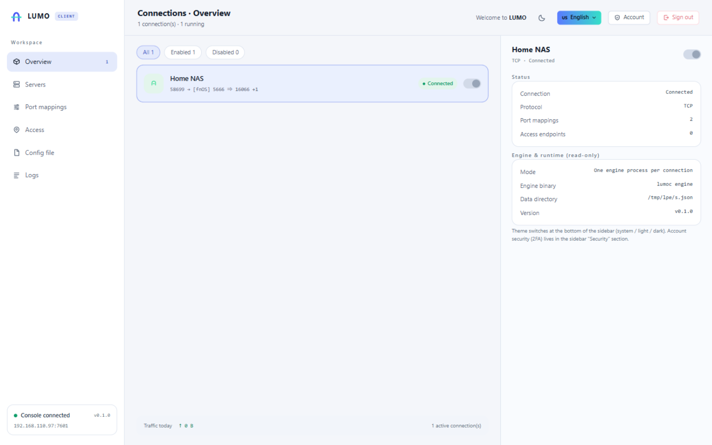

# LUMO 隧光

[English](README.md) | **简体中文**

<p align="center">
  
  
</p>

LUMO（隧光）是一套自成体系的内网穿透工具：把位于 NAT 或防火墙之后的本地服务发布到公网。服务端
`lumos` 跑在有公网 IP 的主机上，客户端 `lumoc` 跑在你的内网里；两者通过带认证的握手建立控制
通道，按需打开数据连接。

- **零第三方依赖** —— 只用 Go 标准库，供应链面极小
- **自有协议** —— 长度分帧的 JSON 控制报文，加 Ed25519 签名；不与其他穿透工具互通
- **双语控制台** —— 内置服务端与客户端面板（中 / 英），实时状态、流量与运行事件
- **可不下发公网端口** —— 密钥隧道（`sealed-tcp` / `sealed-udp`）不开放任何公网入口，
  `punch` 先尝试点对点直连，失败自动回落到中继

## 代理类型（v0.1.0）

| 类型 | 说明 |
|---|---|
| `tcp` | 公网端口映射到内网 TCP 服务 |
| `udp` | 公网端口映射，回包按访问端地址分流 |
| `http` | 按域名路由的虚拟主机（`vhostHTTPPort`） |
| `https` | 按 TLS SNI 路由，TLS 在本地服务侧终结，逐段加密不落中间层 |
| `sealed-tcp` | 密钥隧道，不占公网端口 |
| `sealed-udp` | 密钥隧道（UDP 承载），不占公网端口 |
| `punch` | 交换地址后点对点直连，打洞失败自动回落到中继 |
| `mux` | HTTP CONNECT 多路复用入口端口 |

此外还包括：令牌认证（Ed25519 挑战应答）、断线自动重连与退避、配置热加载、`verify` 配置校验、
TOTP 两步登录、流量统计、运行事件与多连接管理器。

## 多连接控制台（推荐）

不用手写配置文件，直接开 GUI 控制台 `lumoc ui`：新建、编辑、启动、停止任意数量的隧道，全部存在
一个本地 JSON 里，由单个进程托管。

```bash
./bin/lumoc ui                          # 默认 http://127.0.0.1:7400
./bin/lumoc ui -addr 0.0.0.0:7400 -user admin -pass '一个强口令' -store /data/configs.json
```

点「新建连接」，填服务端地址、密钥和端口映射。开关立即启停隧道，不用重启进程。

常用子命令：

```bash
./bin/lumoc init   --store c.json --server 203.0.113.10 --port 58619 --token <密钥>
./bin/lumoc server --out lumos.toml --bind-port 58619 --kcp-port 47011 --web-port 46351
./bin/lumoc discover -c lumoc.toml      # 列出其他客户端注册的密钥隧道
```

## 构建

需要 Go 1.26+ 与 Node.js 20+（Go 二进制不会内嵌未构建的前端）。

```bash
# 1. 构建两个 Vue 3 控制台（web/ 是 npm workspace）
cd web && npm ci && npm run build && cd ..

# 2. 编译二进制（面板通过 //go:embed 内嵌）
make build        # 或：go build -trimpath -ldflags "-s -w" -o bin/lumos ./cmd/lumos
```

只要后端、不内嵌面板：

```bash
go build -tags noweb -o bin/lumos ./cmd/lumos
go build -tags noweb -o bin/lumoc ./cmd/lumoc
```

完整开发流程：

```bash
make all      # env + fmt + web + build
make alltest  # vet + 单元测试 + e2e
```

## 快速开始

服务端 `lumos.toml`：

```toml
bindPort = 58619
kcpPort = 47011
vhostHTTPPort = 18080

[auth]
# 由密钥派生，或调试期沿用明文 auth.token
pubKey = "<Ed25519 公钥>"

[webServer]
addr = "0.0.0.0"
port = 46351
user = "admin"
password = "change-me"
```

`./bin/lumoc server --out lumos.toml ...` 会生成这个文件并打印对应的密钥。

客户端 `lumoc.toml`：

```toml
serverAddr = "203.0.113.10"
serverPort = 58619
protocol = "kcp"
kcpPort = 47011

[auth]
token = "与服务端相同的密钥"

# TCP 隧道
[[proxies]]
name = "ssh"
type = "tcp"
localIP = "127.0.0.1"
localPort = 22
remotePort = 6022

# 按域名路由的 HTTP 隧道
[[proxies]]
name = "site"
type = "http"
localPort = 8080
customDomains = ["app.example.com"]

# 密钥隧道：完全不占公网端口
[[proxies]]
name = "nas-admin"
type = "sealed-tcp"
localIP = "127.0.0.1"
localPort = 5666
sk = "一段足够长的密钥"
```

启动并校验：

```bash
./bin/lumos verify -c lumos.toml   # 只校验不启动
./bin/lumos -c lumos.toml
./bin/lumoc -c lumoc.toml
```

然后打开 `http://127.0.0.1:46351`（服务端控制台）或 `http://127.0.0.1:7400`（客户端控制台），用
`webServer` 里的账号密码登录。

## 安全说明

- `auth.pubKey` 由隧道密钥派生，服务端磁盘上不需要保存密钥本身；密钥请保持 32 位以上
- 面板默认只监听 `127.0.0.1` —— 对外开放前先改密码，并考虑开启 TOTP
- 敏感服务优先用 `sealed-tcp` / `sealed-udp`，不要直接开公网端口
- 日志默认对地址做掩码（`log.MaskAddr`），journal 里不会留下原始 IP

## 目录结构

```
cmd/lumos            服务端入口
cmd/lumoc            客户端入口（ui / engine / discover / init / server）
pkg/config           配置读取、校验与回写
pkg/toml             TOML 子集解析
pkg/proto            线路协议：分帧、认证、报文
pkg/relay            双向拷贝、限速、流量计数
pkg/server           服务端：会话、注册、转发、虚拟主机、控制台
pkg/client           客户端：控制循环、工作连接、访问端、打洞
pkg/manager          多连接管理器与客户端控制台
pkg/auth             Web 会话与登录限流
pkg/token            Ed25519 令牌派生与校验
pkg/totp             RFC 6238 动态口令
pkg/qrcode           独立二维码编码器（用于两步验证绑定）
pkg/udpstream        KCP 可靠 UDP 传输
pkg/stun             STUN 反射地址发现（用于打洞）
pkg/log              日志、地址掩码、运行事件环形缓冲
web/lumos            服务端控制台（Vue 3 + Vite）
web/lumoc            客户端控制台（Vue 3 + Vite）
web/shared           两个控制台共用的 i18n 与工具函数
```

## 参与共建

LUMO 开放共创：

- 缺陷与需求：[Issues](../../issues)
- 开发环境与 PR 流程：[CONTRIBUTING.md](CONTRIBUTING.md)
- 飞牛 fnOS 客户端安装包：[lumo-fpk](https://github.com/j353719624/lumo-fpk)

## 许可

**PolyForm Noncommercial License 1.0.0** —— 可自由使用、学习、修改与分发，**不可商用**。

商用需作者授权，允许范围与申请方式见 [LICENSING.md](LICENSING.md)，完整条款见 [LICENSE](LICENSE)。
